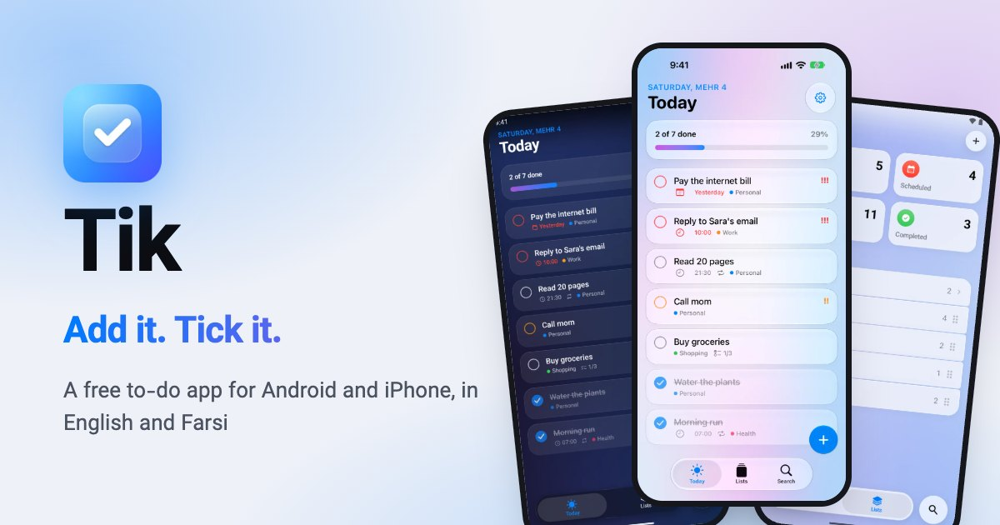

  
  

### 👋 About me

- 🐍 Python developer from Tehran, on my way to becoming an AI engineer
- 🚀 I build things that ship: Telegram bots, mobile apps and web shops
- 🔍 I help websites get found on Google (SEO)
- 📓 I practice Python every day: [python-practice](https://github.com/MahyarMozafar/python-practice)
- 💬 Have a project in mind? [Message me on Telegram](https://t.me/MahyarMozafar)

---

### ✅ Tik: Add it. Tick it.

A minimal, glassy to-do app for **iPhone, iPad and Android**, in English and Farsi. Free.

  
  
  

---

### 🚀 More projects

<table>
  <tr>
    <td width="50%" valign="top">
      <h4>💎 <a href="https://github.com/MahyarMozafar/mozafar-gallery">Mozafar Gallery</a></h4>
      
Online gold and jewellery shop with <b>live prices</b>. Uses the real Iranian price formula, locks stock so a one-of-a-kind piece is never sold twice, and has an admin panel.

      
      
      
    </td>
    <td width="50%" valign="top">
      <h4>🛒 <a href="https://github.com/MahyarMozafar/telegram-shop-bot">Telegram Shop Bot</a></h4>
      
Answers customer questions in Persian, <b>even with typos, even at 2 AM</b>, with no paid AI. The seller adds products just by chatting, and sees what people ask for in a dashboard.

      
      
      
    </td>
  </tr>
  <tr>
    <td width="50%" valign="top">
      <h4>📥 <a href="https://github.com/MahyarMozafar/telegram-video-bot">Media Downloader Bot</a></h4>
      
Send it an Instagram or TikTok link and get the video back in the chat. If the file is over Telegram's 50 MB limit, it lowers the quality by itself.

      
      
    </td>
    <td width="50%" valign="top">
      <h4>🌐 <a href="https://github.com/MahyarMozafar/portfolio">Portfolio</a></h4>
      
My personal site at <a href="https://mahyarmozafar.ir">mahyarmozafar.ir</a>. Persian (RTL), dark and minimal, one page, no frameworks.

      
      
      
    </td>
  </tr>
</table>

---

### 🛠 Tech stack

  
   
  

